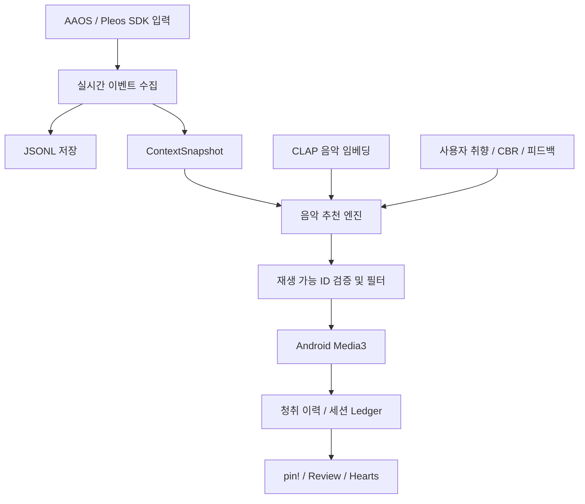

# GleoHearts

### 이동의 순간을 음악으로 기억하다

**GleoHearts는 운전자의 취향과 주행 맥락을 고려해 음악을 추천하고, 드라이브에서 만난 음악을 추억으로 기록하는 차량 연계 음악 서비스입니다.**

차량 안에서 시작된 음악 경험이 운전 종료 후에도 모바일의 기록으로 이어지도록 설계했습니다.

**Discover → Listen → pin! → Review → Hearts**

---

## 1. 프로젝트 소개

### Every drive has a soundtrack.

운전 중 우연히 만난 좋은 음악을 나중에도 기억할 수 있다면 어떨까요?

기존의 음악 서비스가 음악 감상과 개인 취향에 집중했다면, GleoHearts는 여기에 **차량의 주행 맥락과 이동의 기억**을 결합했습니다.

차량에서는 현재 상황에 어울리는 음악을 발견하고, 마음에 드는 음악을 저장합니다. 주행이 끝나면 음악을 정리하고, 모바일에서 날짜·사진·메모와 함께 추억을 돌아볼 수 있습니다.

GleoHearts가 제공하고자 하는 가치는 세 가지입니다.

- **발견(Discover):** 사용자의 취향과 주행 맥락을 고려한 음악 추천
- **기억(Remember):** 운전 중 마음에 드는 음악을 간단하게 저장
- **회상(Rediscover):** 음악과 연결된 이동 경험을 Hearts로 아카이빙

> **개발 현황 안내:** 본 저장소는 공모전 제출용 Android 소스코드와 Release APK를 제공합니다. 차량 데이터 처리, 추천 점수 계산, 음악 재생 및 아카이빙 기능은 개발 환경에서 단계적으로 검증했으며, 공개 APK에는 저작권·배포 범위상 음원 및 AI 모델 파일을 포함하지 않았습니다. 구현·검증 범위는 아래에서 구분합니다.

## 2. 서비스 주요 화면

### 2.1 CAR — 운전 중 음악 경험


차량 환경을 고려해 음악 재생과 핵심 조작에 집중한 화면입니다.

주요 UI 요소:

- 현재 재생 음악 및 재생 상태
- 재생·일시정지·이전 곡·다음 곡
- 개인화 음악 추천과 추천 맥락 안내
- pin! 음악 기억 기능
- 주행 종료 후 Review 진입

### 2.2 MOBILE — 음악과 드라이브 기록

| 홈 | 음악 |
| - | -- |
|   |    |

| 캘린더 | Hearts |
| --- | ------ |
|     |        |

**마이 페이지**


모바일은 홈·캘린더·음악·pin!·마이의 5개 탭으로 구성됩니다.

- **홈:** 드라이브 기록과 최근 Hearts 조회
- **캘린더:** 날짜별 음악 및 이동 기록 조회
- **음악:** 음악 정보·추천·재생 관련 기능
- **pin! / Hearts:** 저장한 음악과 사진·메모·태그 관리
- **마이:** 로컬 사용자 정보와 기록 관리

**화면 자료 안내**

위 스크린샷은 제출용 빌드에서 제작한 **합성 UI fixture**를 포함합니다. 실제 GPS 지도, 사용자 청취 이력, 공식 Pleos 기능 실행이나 CAR↔MOBILE 기기 간 동기화를 증명하는 자료는 아닙니다.

Figma UI/UX 프로토타입은 아래에서 확인할 수 있습니다.

[**GleoHearts — FINAL UI/UX (Figma)**](https://www.figma.com/design/O6E71vxWisvrbMPw3dh5Q4/?node-id=542-25767)

## 3. 핵심 기능

### 3.1 주행 맥락 기반 AI 음악 추천

GleoHearts는 다음 여섯 가지 정보를 음악 추천에 활용하도록 설계했습니다.

| 주행 맥락  | 활용 정보               |
| ------ | ------------------- |
| 위치     | 현재 위치, 이동 및 체류 맥락   |
| 목적지    | 내비게이션 목적지 및 이동 목적   |
| 운전 행동  | 차량 속도 및 운전 관련 신호    |
| 도로 상황  | 교통 흐름 및 경로 관련 정보    |
| 시간·날씨  | 시간대, 요일, 기상 조건      |
| 사용자 발화 | 명시적인 음악 요청 및 분위기 선호 |

`ContextSnapshot`은 수집한 정보를 하나의 추천 맥락으로 구성합니다. 각 정보의 출처·관측 시각·유효성·누락 여부를 구분하며, 수신되지 않은 값을 임의로 생성하지 않습니다.

**현재 검증 범위**

- AAOS 속도 콜백 수신
- JSONL 이벤트 저장
- ContextSnapshot 구성
- 수집된 속도 맥락의 추천 점수 반영
- 500곡 대상 추천 점수 계산

위치·목적지·도로·날씨·공식 음성 기능 등 모든 맥락이 실제 운영 환경에 연결된 것은 아닙니다.

### 3.2 개인화 음악 추천

음악의 음향 특징과 사용자 취향, 주행 맥락, 피드백 이력을 결합하는 추천 구조를 구현하고 있습니다.

주요 기술 요소는 다음과 같습니다.

| 기술                | 역할                            |
| ----------------- | ----------------------------- |
| CLAP              | 음악 특징을 벡터로 표현                 |
| Cosine similarity | 사용자 취향과 음악 간 유사도 계산           |
| CBR               | 과거 맥락·청취·피드백 사례 기반 개인화        |
| Context scoring   | 유효한 주행 맥락에 따른 점수 보정           |
| Feedback learning | 명시적 선호 및 검증된 청취 신호 반영         |
| Playback mapping  | 모델의 음악 ID와 실제 재생 가능한 음악 ID 연결 |

원본 연구·개발 환경에서는 **500곡 × 512차원 음악 임베딩**을 기반으로 추천 점수를 계산했습니다.

초기 취향 가중치(장르 0.6 / 분위기 0.4), 학습률 0.15 및 K-Means·GMM 분석 설정은 실험을 위한 값이며, 실제 사용자 성능이 검증된 최적값을 의미하지 않습니다.

**분석 가능 곡과 재생 가능 곡은 구분합니다.**

최근 개발 환경 진단에서는 다음을 확인했습니다.

| 항목                      | 결과   |
| ----------------------- | ---- |
| AI 모델 분석 대상             | 500곡 |
| 실제 재생 ID로 검증된 매핑        | 1곡   |
| 기존 청취곡 제외 정책 적용 후 재생 후보 | 0곡   |
| 모델과 재생 ID가 연결되지 않은 곡    | 499곡 |

검증된 매핑은 `jamendo_api_1559614 → jamendo_0010`입니다.

이 결과는 분석 엔진이 500곡을 처리한다는 의미이며, **500곡 전체가 실제 재생 가능하다는 의미는 아닙니다.**

### 3.3 Android Media3 음악 재생

Android Media3 및 MediaSession 기반으로 다음 기능을 구성했습니다.

- 음악 재생 및 일시정지
- 이전 곡 / 다음 곡 이동
- 현재 재생 상태 표시
- 재생 이벤트 및 청취 구간 기록
- 실제 재생 세션 식별자 관리

개발 환경의 승인된 로컬 테스트 음원을 이용하여 기본 재생 조작을 검증했습니다.

**공개 Release APK에는 음원 파일이 포함되어 있지 않으므로 실제 음악 재생에 제약이 있습니다.** UI 조작이 가능하다는 사실을 음원 재생 성공과 혼동하지 않습니다.

### 3.4 pin! — 음악을 기억하는 순간

운전 중 마음에 드는 음악을 기록할 수 있도록 설계한 기능입니다.

기록에는 가능한 범위에서 다음 정보를 연결합니다.

- 음악 ID 및 메타데이터
- 주행 수집 세션
- 기록 시각
- 실제 관측된 위치 정보
- 사용자 메모 및 태그

pin! 저장은 추천 엔진의 자동 좋아요 신호로 취급하지 않습니다.

### 3.5 Review — 주행이 끝난 후 음악 정리

주행 종료 후 관측된 음악 기록을 확인하고, Hearts에 남길 음악을 선택하는 기능입니다.

- 음악 카드 탐색
- 위로 스와이프하여 저장 대상에서 제외
- 제외 취소 및 복원
- 선택한 음악을 Hearts에 저장

Review에서 음악을 제외하는 행동은 음악 파일 삭제나 부정적 선호 학습을 의미하지 않습니다.

차량 환경의 편집 기능은 플랫폼의 운전자 주의 분산 제한 정책을 고려해 제어하도록 구성했습니다. 실차에서 모든 주행·정차 전이가 검증된 것은 아닙니다.

### 3.6 Hearts — 드라이브 아카이빙

저장한 음악을 날짜와 개인 기록에 연결하는 로컬 아카이빙 기능입니다.

- 음악별 기억 저장
- 사진·메모·태그 연결
- 날짜별 조회
- 저장 항목 검색
- 수정·삭제·복원

개발 환경에서는 기존 로컬 저장소와 주행 기록 조회 경로를 활용합니다.

현재 공개 버전은 **계정 기반 클라우드 서비스나 서로 다른 기기 사이의 실시간 동기화가 완료된 제품이 아닙니다.**

## 4. 시스템 아키텍처

### 데이터 흐름



**주요 식별자**

- `driveSessionId`: 앱의 주행 데이터 수집 세션
- `contextSnapshotId`: 추천 시점의 맥락 정보
- `recommendationId`: 추천 요청 및 결과
- `musicId`: 음악 식별자
- `playbackSessionId`: 실제 재생 세션
- `feedbackEventId`: 피드백 이벤트

각 데이터는 검증된 연결 관계를 기준으로 추적하며, 모든 화면이 위 식별자를 직접 보유하는 것은 아닙니다.

### 기술 스택

| 구분              | 기술                                   |
| --------------- | ------------------------------------ |
| Language        | Kotlin 2.2.10                        |
| UI              | Jetpack Compose                      |
| Android         | Android Automotive OS / Android      |
| Audio           | AndroidX Media3 1.11.1               |
| Vehicle SDK     | Pleos Vehicle 2.3.2                  |
| Navigation      | Pleos NaviHelper 3.0.5               |
| Location        | Pleos FusedLocation 1.1.3            |
| Recommendation  | CLAP, cosine similarity, CBR         |
| Data Processing | ContextSnapshot, RealtimeEventBuffer |
| Local Storage   | JSONL, 로컬 아카이브                       |
| Build           | Gradle Wrapper 9.6.0                 |
| Design          | Figma                                |

## 5. APK 다운로드 및 설치

### 공모전 제출용 Release APK

[**GleoHearts Release APK 다운로드 페이지**](https://github.com/pparkpparkyi/GleoHearts/releases/tag/v1.0.0-submission)

| 항목         | 내용                                  |
| ---------- | ----------------------------------- |
| Release 버전 | `v1.0.0-submission`                 |
| APK 파일명    | `GleoHearts_GleoHearts_release.apk` |
| 배포 방식      | GitHub Releases                     |
| 패키지 ID     | `com.gleohearts.submission`         |

GitHub 웹 업로드 용량 제한으로 인해 APK 파일을 저장소의 `apk/` 디렉터리 대신 **GitHub Releases**에 등록했습니다. 이는 공모전 안내에서 허용한 제출 방식입니다.

### APK 설치 방법

1. 위 GitHub Release 페이지에 접속합니다.
2. **Assets** 항목에서 `GleoHearts_GleoHearts_release.apk`를 다운로드합니다.
3. 지원되는 Android 기기 또는 Android Automotive 테스트 환경에 APK를 설치합니다.
4. 앱을 실행하여 CAR 또는 MOBILE 화면을 확인합니다.

APK는 Release 형식으로 생성되어 서명 검증을 통과했다고 보고되었으나, **공개 Release APK의 최종 실기기 설치·실행 및 Media3 재생 종단 검증은 별도 확인이 필요합니다.**

또한 공개 APK에는 음악 파일·AI 모델·외부 서비스 인증 정보가 포함되어 있지 않습니다.

## 6. 소스코드 실행 방법

### 개발 환경

- Android Studio
- Android Studio JBR / JDK 25 검증 환경
- Android SDK Platform 37
- Gradle Wrapper 9.6.0
- Android SDK Build Tools
- 관련 Android 및 Pleos SDK 의존성

### 프로젝트 실행

1. GitHub 저장소를 Clone하거나 ZIP 파일로 내려받습니다.
2. Android Studio에서 프로젝트 폴더를 엽니다.
3. Android SDK 경로를 설정합니다.
4. 필요한 의존성이 해결되면 Gradle Sync를 실행합니다.
5. Android 또는 AAOS 테스트 기기를 선택해 앱을 실행합니다.

**빌드 명령**

```bash
./gradlew assembleDebug testDebugUnitTest
```

Windows에서는 다음 명령을 사용할 수 있습니다.

```powershell
.\gradlew.bat assembleDebug testDebugUnitTest
```

개발용 APK 출력 경로:

```text
app/build/outputs/apk/debug/app-debug.apk
```

**참고 사항**

- 공개 Release APK와 개발용 Debug APK는 서로 다른 산출물입니다.
- 원본 개발 환경은 기존 로컬 의존성 캐시를 이용한 오프라인 빌드로 검증되었습니다.
- 새로운 PC에서 모든 외부 의존성을 온라인으로 내려받는 절차는 별도 검증이 필요합니다.
- Pleos SDK의 이용 조건과 접근 권한을 준수해야 합니다.
- `local.properties`, API 키, 서명 키 및 사용자 데이터는 GitHub 저장소에 포함하지 않습니다.
- 공개 제출본에는 외부 지도 API 키가 없으며 지도 관련 화면은 이미지 기반 대체 표현을 포함합니다.

## 7. 테스트 환경 및 검증 결과

### 7.1 Android 테스트 환경

| 환경                      | 확인된 내용                                     |
| ----------------------- | ------------------------------------------ |
| Samsung Galaxy SM-F766N | Android 17 / API 37                        |
| 일반 AAOS 에뮬레이터           | Google Automotive / API 35                 |
| 공식 Pleos Connect 테스트 환경 | Pleos Connect 2.1.0 / Android API 34 사용 이력 |

**Pleos 화면 규격 관련 안내**

개발 과정에서 공식 Pleos Connect 2.1.0 에뮬레이터의 앱 창 크기 **1682 × 1210px**가 관측된 기록이 있습니다.

이는 해당 테스트에서 측정한 **앱 창 크기**이며, Pleos 시스템 전체 디스플레이의 규격이나 모든 지원 차량의 고정 해상도를 의미하지 않습니다.

일반 Google Automotive API 35 환경에서 수행한 최종 AAOS 진단·시연은 공식 Pleos Connect 2.1.0에서의 동일 기능 검증으로 간주하지 않습니다.

### 7.2 공개 제출용 소스 검증

| 검증 항목                     | 결과                             |
| ------------------------- | ------------------------------ |
| Kotlin 컴파일 및 Debug APK 빌드 | 성공                             |
| 계측 APK 빌드                 | 성공                             |
| JVM 단위 테스트                | 275 pass / 56 skip / 0 failure |
| Galaxy 계측 테스트             | 4 pass                         |
| 일반 AAOS 계측 테스트            | 3 pass                         |
| 공개본의 실제 음악 재생             | 음원 미포함으로 검증 불가                 |
| 공개본의 500곡 AI 모델 실행        | 모델 미포함으로 검증 불가                 |

JVM의 56개 skip 항목은 모델 및 선택적 검증 입력 등의 부재로 인한 결과입니다. Skip을 성공으로 계산하지 않았습니다.

이 수치는 공개용 소스 스냅샷 검증 결과이며, 별도의 원본 개발 환경에서 수행한 최신 실험 결과와 구분해야 합니다.

[검증 상세 보고서](docs/VALIDATION.md) · [Skip 테스트 목록](docs/TEST_SKIPS.md)

### 7.3 원본 개발 환경의 추가 검증

최근 원본 개발 환경에서는 다음과 같은 결과를 확인했습니다.

| 검증 항목             | 결과                          |
| ----------------- | --------------------------- |
| JVM               | 344 pass / 4 skip           |
| Python            | 67 pass                     |
| Debug 및 계측 APK    | 빌드 성공                       |
| 격리 AAOS V13 UI 계측 | 2 pass                      |
| 실제 AAOS 전체 종단 경로  | CarService/SystemUI 장애로 미완료 |

원본 개발 환경에서는 실제 AAOS 속도 입력과 ContextSnapshot을 연결해 500곡 추천 점수 계산이 수행됨을 확인했습니다.

정차에서 저속으로 변경한 시험에서는 맥락 보정 점수 차이가 관측되었지만, 상위 10곡의 추천 순서는 변경되지 않았습니다.

이러한 결과는 **개발 환경의 기능 검증**이며, 공개 Release APK의 동일한 기능 작동을 보장하지 않습니다.

## 8. 구현 범위와 현재 제한 사항

GleoHearts는 서비스 기획, UI/UX 설계, Android 구현, 주행 데이터 수집 및 추천 모델링을 통합해 개발 중인 프로젝트입니다.

### 현재 구현 및 검증한 영역

- CAR / MOBILE Android UI 구조
- 차량 속도 이벤트 수집과 JSONL 기록
- ContextSnapshot 및 데이터 유효성 관리
- 500곡 대상 음악 추천 점수 계산
- 개발 환경에서의 Media3 음악 재생
- 로컬 pin!·Review·Hearts 데이터 처리 구조
- 추천 결과와 실제 재생 가능 후보의 분리
- 청취·피드백·재생 식별자 관계 추적

### 추가 고도화가 필요한 영역

- 실제 재생 가능한 음악 카탈로그 확장
- 공식 Pleos 환경에서의 안정적인 종단 검증
- 위치·내비게이션·날씨·음성 기능의 실서비스 연동
- CAR↔MOBILE 기기 간 동기화
- 실차 기반 주행 맥락 검증
- 음악 라이선스 및 배포 체계 확보
- 장시간 실행 및 다양한 차량 환경의 안정성 검증

현재 APK를 실제 차량용 상용 서비스 또는 Pleos 공식 인증을 완료한 제품으로 표현하지 않습니다.

## 9. 공개 자료 범위 및 저작권

### 공개 저장소에 포함하지 않은 자료

- 저작권 및 배포 권한 검토가 필요한 MP3
- 원본 CLAP 모델·임베딩·음악 메타데이터
- 실제 차량·위치·청취 기록
- 사용자 개인정보와 개인 사진
- 배포 권한이 확인되지 않은 디자인 자산
- API 키·인증 파일·서명 키

공개용 스크린샷의 합성 UI와 원본 실측 데이터는 명확히 구분합니다.

본 저장소는 공모전 심사를 위한 제출 자료이며, 기존 팀 기여자의 코드나 제3자 자료에 대해 새로운 포괄적 이용 권한을 부여하지 않습니다.

### 관련 문서

- [공개 범위](docs/EXPORT_SCOPE.md)
- [자산 목록](docs/ASSETS.md)
- [검증 결과](docs/VALIDATION.md)
- [기여자 안내](AUTHORS.md)
- [권리 안내](COPYRIGHT.md)
- [제3자 고지](THIRD_PARTY_NOTICES.md)

## 10. 팀 및 관련 링크

### Competition Team — GleoHearts

**참가자**

- 박서진
- 임채연

공모전 참가자와 저장소의 개별 코드 작성자는 구분합니다. 기존 팀 프로젝트의 기여 관계를 존중하며, 특정 개발 기능의 저작자를 확인 없이 단정하지 않습니다.

**관련 GitHub 계정 및 기여 기록**

- `pparkpparkyi`: 현재 프로젝트 확장 개발 및 제출 관리
- `YUZE`: 기존 팀 기준 코드의 Git 기여 기록

### 프로젝트 링크

[**GleoHearts GitHub Repository**](https://github.com/pparkpparkyi/GleoHearts)

[**GleoHearts Release APK**](https://github.com/pparkpparkyi/GleoHearts/releases/tag/v1.0.0-submission)

[**GleoHearts Figma — UI/UX**](https://www.figma.com/design/O6E71vxWisvrbMPw3dh5Q4/GleeOh?node-id=542-25767\&t=S4dbjXIzhMfkqxlv-1)

[**Original Team Repository**](https://github.com/rock-with-u/gleo_type)

---

### GleoHearts

**이동의 순간을 음악으로 기억하다.**

*Every drive has a soundtrack.*
