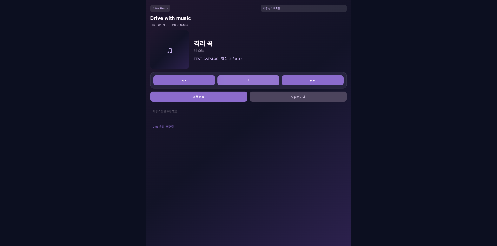
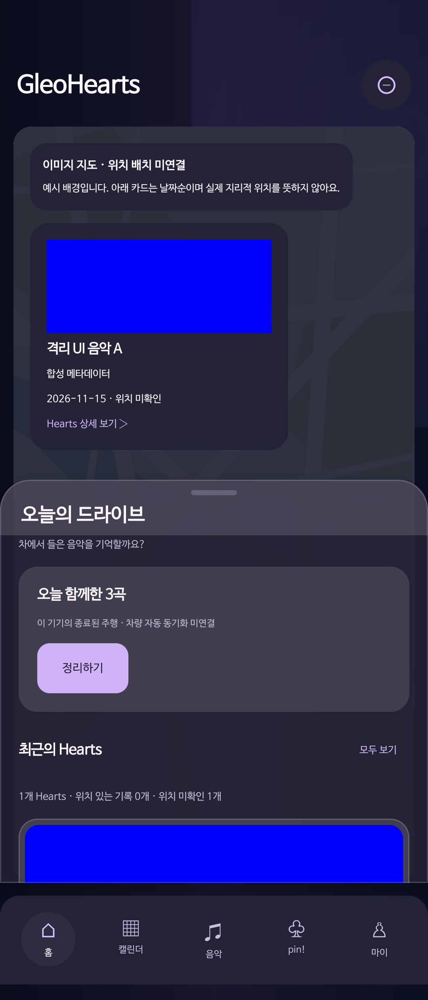
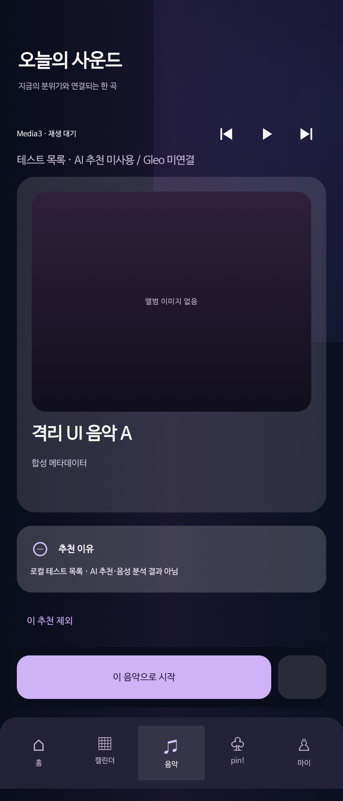
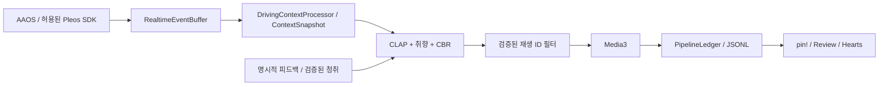

# GleoHearts

### 이동의 순간을 음악으로 기억하다

**주행 상황에 맞는 음악을 발견하고, 마음에 남은 곡을 나만의 Hearts로 이어가는 CAR·MOBILE Android 프로젝트입니다.**

`상황에 맞는 추천 → 음악 재생 → pin! → 주행 종료 Review → Hearts`

## 1. 프로젝트 소개와 기획 배경

운전 중 마음에 들었던 음악을 나중에 다시 찾고, 그날의 이동과 함께 기억할 수 있다면 어떨까요?

GleoHearts는 음악 추천과 이동 기록을 하나의 경험으로 연결하기 위해 시작했습니다. 차량에서는 주행 맥락과 사용자 취향을 바탕으로 음악을 제안하고, 기억하고 싶은 곡을 간단히 남깁니다. 주행이 끝나면 Review에서 곡을 정리하고, 모바일의 사진·메모·날짜와 함께 Hearts로 돌아볼 수 있도록 설계했습니다.

- **발견:** 지금의 이동 상황과 나의 취향을 함께 고려하는 음악 추천
- **기억:** 듣던 음악을 pin!으로 남기고, 주행 후 선택한 곡을 Hearts에 저장
- **회상:** 홈·캘린더·Hearts에서 음악과 연결된 로컬 기록 다시 보기

아래 화면과 기능 설명은 서비스 경험과 구현 구조를 소개합니다. 공개 제출본의 실행 범위와 실제 검증 결과는 [구현 현황·테스트](#7-구현-현황과-테스트-결과)에서 구분합니다.

## 2. CAR·MOBILE 대표 화면

> **기존 제출 빌드에서 촬영한 합성 UI fixture입니다.** 실제 청취 이력·음악 재생·기기 간 동기화의 증거가 아닙니다. 파란 사진은 자체 생성 시험 이미지이며 개인 사진이 아닙니다. 공개본의 빈 카탈로그 상태와 화면 구성을 구분해 봐 주세요.

### CAR — 음악과 핵심 조작에 집중

<a href="docs/screenshots/car-ui-fixture.png"></a>

### MOBILE — 발견한 음악을 기록으로

<table>
  <tr>
    <th>홈 · 오늘의 드라이브</th>
    <th>음악 · 추천과 플레이어</th>
  </tr>
  <tr>
    <td align="center"><a href="docs/screenshots/home.png"></a></td>
    <td align="center"><a href="docs/screenshots/music.png"></a></td>
  </tr>
  <tr>
    <th>캘린더 · 날짜별 기록</th>
    <th>Hearts · 음악과 추억</th>
  </tr>
  <tr>
    <td align="center"><a href="docs/screenshots/calendar.png"></a></td>
    <td align="center"><a href="docs/screenshots/hearts.png"></a></td>
  </tr>
</table>

### 마이 — 취향과 데이터 관리

<a href="docs/screenshots/my.png"></a>

모든 이미지는 클릭하면 기존 원본 크기로 볼 수 있습니다. CAR V13 및 MOBILE V13 셸은 기존 기능 연결 화면과 결합된 하이브리드 구현이며, Figma 완전 일치를 의미하지 않습니다.

## 3. 핵심 기능

| 기능 | 사용자 경험과 구현 내용 |
|---|---|
| **6대 주행 맥락 추천** | 위치·목적지·운전 행동·도로·시간/날씨·발화를 출처와 품질 상태를 가진 입력으로 다룹니다. 실제 수집되지 않은 값은 채우지 않습니다. |
| **Media3 음악 재생** | 현재 곡·재생/일시정지·이전/다음을 실제 Media3 콜백에 연결합니다. UI 클릭만으로 재생 성공을 표시하지 않습니다. |
| **pin! · 순간 기억** | 재생 중 기억하고 싶은 음악을 세션과 연결해 로컬 Hearts에 남기는 경로입니다. 저장 행위를 자동 LIKE로 학습하지 않습니다. |
| **주행 종료 Review** | 관측된 곡을 좌우로 탐색하고 위로 스와이프해 저장 후보에서 제외합니다. 취소·복원 후 선택한 곡만 Hearts에 저장합니다. 제외는 MP3 삭제나 DISLIKE가 아닙니다. |
| **Hearts 아카이빙** | 로컬 기록 검색, 사진·메모·태그, 수정·삭제·복원을 지원합니다. 홈과 캘린더에서 연결된 기록을 조회하는 구조를 사용합니다. |

홈은 이미지 지도와 바텀시트로 기록을 보여줍니다. 이미지 위 카드 배치는 GPS 좌표 매핑이 아닙니다. 모바일은 홈·캘린더·음악·pin!·마이의 5개 탭으로 구성됩니다.

**공개 제출본에는 음원이 없어 실제로 재생할 곡이 없습니다.** 위 표는 포함된 코드와 연결 구조를 설명하며, 기능별 제출 사본 검증 범위는 아래 결과표를 기준으로 합니다. 계정 로그인이나 CAR↔MOBILE 클라우드 동기화가 완료된 서비스로 표현하지 않습니다.

## 4. AI 추천 시스템

### CLAP · 취향 · 맥락 · CBR의 결합

| 요소 | 역할 |
|---|---|
| **CLAP** | 원본 연구 환경의 500곡 × 512차원 음악 임베딩을 사용합니다. |
| **사용자 취향** | 초기 장르·분위기 선택으로 취향 벡터를 구성하고 cosine 유사도를 계산합니다. |
| **차량 맥락** | 유효한 관측값만 맥락 보정에 사용하고, 없는 값과 오래된 값을 구분합니다. |
| **CBR** | 사용자별 맥락·음악·피드백 사례를 활용하는 개인화 경로입니다. |
| **재생 후보 필터** | 추천 점수를 계산할 수 있는 곡과 실제 재생 가능한 musicId를 분리합니다. |

초기 장르 **0.6** / 분위기 **0.4**, 학습률 **0.15**는 실험 설정입니다. 최적값이나 실사용자 성능으로 주장하지 않습니다. **K-Means 8 / GMM 9**는 분석용이며, 성능 검증 없이 운영 랭킹에 가산하지 않습니다.

### 피드백의 의미를 구분합니다

명시적 LIKE/DISLIKE와 약한 청취 신호를 구분합니다. NEXT·PAUSE·Hearts 저장·Review 제외를 자동 긍정·부정 선호로 처리하지 않으며, playbackSessionId와 Ledger 이벤트를 기준으로 중복 학습을 방지합니다.

모든 맥락이 실제 SDK에 연결된 상태는 아닙니다. 낮은 속도를 정체로 확정하지 않고, stale·future·unknown 데이터는 유효한 차량 특징으로 전달하지 않습니다. 모델·권한 조건이 충족되지 않으면 TEST_CATALOG 또는 기존 취향 기반 fallback으로 전환합니다.

## 5. 기술 스택과 아키텍처

| 계층 | 기술·구성 |
|---|---|
| Android UI | Kotlin 2.2.10 · Jetpack Compose · CAR/MOBILE 화면 |
| 음악 재생 | Media3 1.11.1 · MediaSession |
| 차량·위치·내비 | AAOS · Pleos Vehicle 2.3.2 · NaviHelper 3.0.5 · FusedLocation 1.1.3 |
| 실시간 처리 | RealtimeEventBuffer · DrivingContextProcessor · ContextSnapshot |
| 추천·학습 | CLAP · 사용자 취향 · CBR · 검증된 재생 ID 필터 |
| 기록·추적 | PipelineLedger · JSONL · 로컬 Hearts 저장소 |
| 기타 | AndroidSVG · Maps Compose 코드 보존, 이미지 지도 fallback |

### 추천에서 기록까지의 데이터 흐름



관측값·추론값·누락값·오래된 값의 출처와 최신성을 유지합니다. 실제 재생은 Media3 콜백을 단일 상태 원천으로 사용하고, 기록은 기존 세션 ID와 연결합니다.

ID 관계는 `driveSessionId → contextSnapshotId → recommendationId → playbackSessionId → musicId → pin! → Review → Hearts`입니다. Review-only/수신 기록은 모든 ID를 직접 보유하지 않아 원본 Ledger 계보가 필요한 부분이 남아 있습니다.

## 6. 설치 및 실행 방법

1. Android Studio와 JDK25(Android Studio JBR로 검증), Android SDK Platform37·Build Tools 및 SDK 라이선스를 준비합니다. minSdk28/target37입니다.
2. Android Studio에서 이 저장소 폴더를 열고 SDK 경로를 설정합니다. `local.properties`는 개인 PC에서 생성되며 커밋하지 않습니다.
3. Gradle Wrapper9.6.0을 사용합니다. 의존성은 Google Maven/Maven Central/공식 Pleos Maven에서 받습니다. 초기 빌드는 네트워크와 해당 SDK 이용 자격이 필요할 수 있습니다. SDK 인증/조건을 우회하지 않습니다.

```sh
./gradlew compileDebugKotlin assembleDebug testDebugUnitTest
```

Windows에서는 `gradlew.bat`을 사용합니다. 이번 제출 검증은 기존 로컬 의존성 캐시로 `--offline --no-daemon --no-configuration-cache --max-workers=1`을 사용했습니다. 이는 신규 PC의 온라인 의존성 다운로드가 검증됐다는 의미가 아닙니다.

- applicationId: `com.gleohearts.submission` (원본 설치 앱과 데이터 분리)
- namespace: `com.example.gleo_type`
- Run 구성: `app`, 일반 스마트폰은 모바일5탭, FEATURE_AUTOMOTIVE 기기는 CAR 경로.
- APK: app/build/outputs/apk/debug/app-debug.apk. 빌드 결과 APK는 Git에 포함하지 않습니다.
- Release APK: [다운로드](https://github.com/pparkpparkyi/GleoHearts/releases/tag/v1.0.0-submission)
- APK 파일명: `GleoHearts_GleoHearts_release.apk`
- 핵심 라이브러리: Kotlin2.2.10/Compose/Media3 1.11.1, Pleos Vehicle2.3.2/NaviHelper3.0.5/FusedLocation1.1.3, AndroidSVG, Maps Compose(기존 코드 보존·키 없음).

Google Maps 키/서버/외부 계정은 기본 실행에 필요하지 않습니다. Maps는 이미지 기반 fallback이며 분석 전송 endpoint는 공개 사본에서 비워 자동 업로드를 비활성화했습니다. 공식 Pleos Vehicle/Navi/Gleo 기능은 실제 지원 서비스와 권한이 별도로 필요합니다. Google Automotive 이미지에 AVD 이름만 Pleos인 경우 공식 환경으로 보지 않습니다. 시스템 Status Bar/Driving View/GNB를 앱에서 재현하지 않습니다.

## 7. 구현 현황과 테스트 결과

### 공개 제출본 — source-only 환경

| 검증 대상 | 결과 |
|---|---|
| Kotlin 컴파일 · debug APK · 계측 APK | 성공 |
| **JVM** | **275 pass / 56 skip / 0 failure / 0 error** — 총 331건 |
| **Galaxy** | **4 pass** — 실제 빈 Media3 카탈로그 1건, V13 UI·셸·사진 없는 Review 재검증 3건 |
| **일반 AAOS** | **3 pass** — 실제 빈 카탈로그와 V13 fixture |
| 실제 음악 재생 · 실제 500곡 모델 | 이 공개 사본에서 미검증 |

56개 skip은 모델·리플레이·선택적 참조 입력이 없기 때문이며 통과로 계산하지 않았습니다. 원본 모델을 빌려 공개본 결과를 부풀리지 않았고, 모델 의존 시험과 합성 수치·저장·상태 시험을 구분합니다.

최초 Galaxy UI 2건은 화면이 꺼진 상태에서 Compose 계층을 찾지 못해 실패했습니다. 사용자 잠금 해제 후 같은 빌드로 재검증해 통과했으며, 초기 실패를 숨기거나 앱 코드 오류로 단정하지 않았습니다. Galaxy는 SM-F766N / Android 17·API 37, 일반 AAOS는 Google Automotive API 35입니다.

[검증 보고서와 계측 실행 방법](docs/VALIDATION.md) · [56개 skip 테스트 목록](docs/TEST_SKIPS.md)

### 원본 개발 환경 — 공개 제출본과 별도 결과

| 대상 | 기존 문서에 기록된 결과 |
|---|---|
| JVM | 327 pass / 4 skip |
| Python | 67 |
| Galaxy | 17 |
| 일반 AAOS | 9 |

위 수치는 음원·모델이 제외된 현재 제출 사본의 결과가 아닙니다. 이번 README 개편에서 테스트를 새로 실행하거나 수치를 변경하지 않았습니다. 실제 사용자 취향·추천 성능 향상의 증거로 해석하지 않습니다.

## 8. 공개 제출 범위와 검증 제한

이 저장소는 **공모전 검토용 source-only 제출본**입니다. 검증된 소스를 정제한 사본이며, 공개를 위해 새로운 UI 기능을 추가한 것은 아닙니다.

### 포함하지 않은 자료

- 원본 개발 앱의 **MP3 11개**와 앨범 커버
- **500곡 모델·임베딩·메타데이터**
- 실제 주행·위치·청취 기록, 사용자 프로필과 개인 사진
- 재배포 권한 미확인 **Figma SVG** 및 불확실한 이미지 자산
- API 키·인증 파일·개인 SDK 경로·빌드 캐시·APK

빈 카탈로그와 TEST_CATALOG는 공개본의 정상 상태입니다. 임의의 대체 음원·모델을 만들거나 곡 ID를 연결하지 않으며, 음원 없이 재생 성공을 표시하지 않습니다.

원본 검증 매핑은 `jamendo_api_1559614 → jamendo_0010`입니다. 공개본에서 이 곡이 재생된다는 뜻은 아닙니다. 개인 모델·음원을 사용하려면 배포·이용 권한 및 기존 manifest/해시 계약을 먼저 확인해야 합니다. 이 저장소는 음원 다운로드 URL이나 개인 Drive ID를 제공하지 않습니다.

### 완료로 주장하지 않는 항목

- Figma 완전 일치와 공개본의 원본 SVG 재현
- 공식 Pleos·Gleo 런타임과 실제 음성 실행
- 실차 검증 및 실제 CAR↔다른 MOBILE 종단 동기화
- 지도 인증·계정 서비스·클라우드 동기화
- 원본 환경의 초기 AAOS 재생 준비 지연 및 CarService/SystemUI 실패 해결

미승인 SVG는 제외해 일부 아이콘·효과를 자체 Compose 도형으로 표시합니다. 공개본은 로컬 저장·세션·청취·개인화 코드와 CAR/MOBILE UI를 포함하지만, 자산·권한·실행 환경이 필요한 기능까지 모두 검증된 제품은 아닙니다.

[공개 범위](docs/EXPORT_SCOPE.md) · [포함 자산 목록](docs/ASSETS.md)

## 9. 디자인·검증 문서·기여와 권리

### 디자인과 문서

- [최종 Figma — FINAL 542:25767](https://www.figma.com/design/O6E71vxWisvrbMPw3dh5Q4/?node-id=542-25767)
- [공개 제출본 검증 결과·실행 명령](docs/VALIDATION.md)
- [모델 등 선택적 입력 부재로 skip한 테스트](docs/TEST_SKIPS.md)
- [공개 제출 범위](docs/EXPORT_SCOPE.md)
- [자산 목록](docs/ASSETS.md)

### 공모전 참가와 코드 기여를 구분합니다

**공모전 참가팀: 박서진 · 임채연**

공모전 팀 참가 사실과 개별 코드의 작성·기여 관계는 별개입니다. 확인되지 않은 개발·디자인·AI 역할을 두 참가자에게 임의로 배정하지 않습니다.

- **pparkpparkyi:** 현재 확장 개발 및 제출 관리.
- **YUZE:** 기존 팀 baseline의 Git author로 확인된 기여자. 기존 기여를 현재 제출자의 단독 저작으로 바꾸지 않습니다.
- 파일별 저작권 소유나 참가자와 Git 계정의 대응 관계는 확인되지 않은 범위를 추정하지 않습니다.

[기여 이력 안내 — AUTHORS](AUTHORS.md) · [권리 안내](COPYRIGHT.md) · [제3자 고지](THIRD_PARTY_NOTICES.md)

원본 팀 저장소는 [rock-with-u/gleo_type](https://github.com/rock-with-u/gleo_type), 참조 Fork는 [pparkpparkyi/gleo_type](https://github.com/pparkpparkyi/gleo_type)입니다. **현재 저장소는 독립 source snapshot이며 팀 Git 이력을 가져오지 않았습니다.**

이 공개본은 새로운 포괄적 오픈소스 라이선스 부여를 의미하지 않습니다. 기존 기여자의 권리를 유지하며, 팀 코드 복제 허용을 외부 음원·모델·Figma 자산·SDK의 재배포 승인으로 확대하지 않습니다. 상세 조건은 위 권리 문서를 따릅니다.
