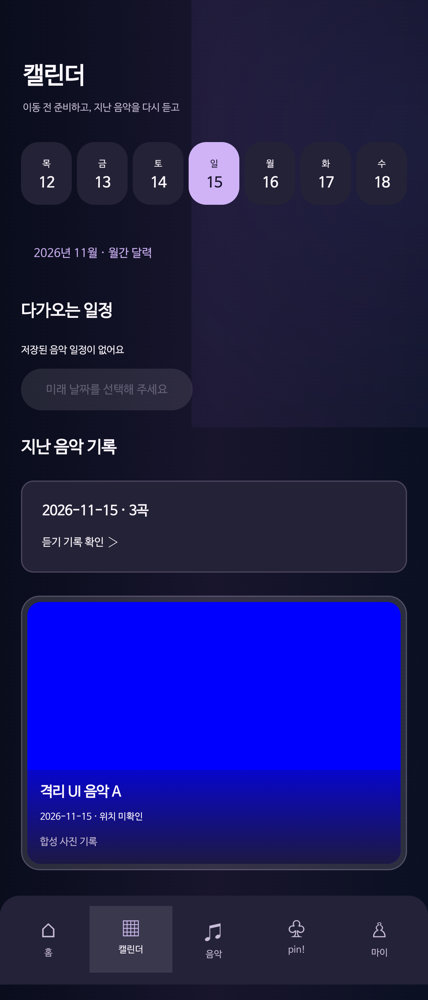
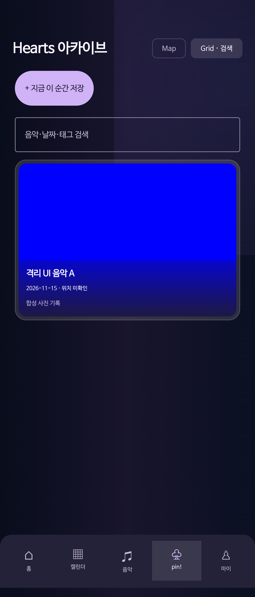
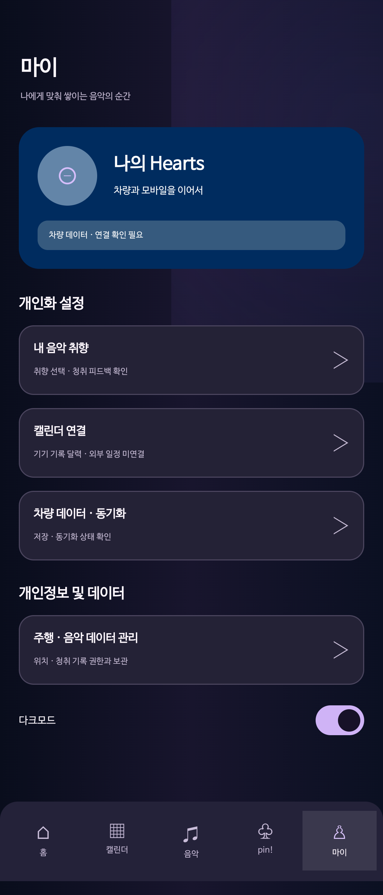
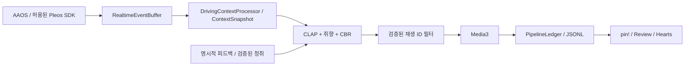

# GleoHearts

차량에서 발견한 음악을 이동 기록과 함께 기억하는 CAR·MOBILE Android 앱입니다.
차량 맥락과 사용자 취향으로 음악을 제안하고, `pin! → Review → Hearts`로 기록을 정리합니다.

**공모전 검토용 source-only 제출본**입니다. 원본 개발 앱의 MP3 11개,500곡 모델·임베딩·메타데이터, 개인 기록/사진, 재배포 권한 미확인 Figma SVG는 포함하지 않습니다. 빈 카탈로그/TEST_CATALOG는 정상적인 공개본 상태이며, 음원 없이 실제 재생 성공으로 표시하지 않습니다. 신규 UI 기능을 추가하지 않고 검증된 소스를 정제했습니다.

## 화면과 기능

- CAR V13: 실제 Media3 재생 상태·이전/다음·차량 연결/unknown·추천 출처·즉시 pin! 저장.
- MOBILE V13 셸: 홈·캘린더·음악·pin!·마이. 기존 기능 연결 화면과 V13 셸의 하이브리드입니다.
- 홈: 이미지 지도와 바텀시트. 배경상의 카드 배치는 GPS 좌표 매핑이 아닙니다.
- Hearts: 로컬 기록 검색·메모/태그·사진·수정·삭제/복원. 계정 로그인/클라우드 동기화 완료로 표현하지 않습니다.
- 주행 종료 Review: 관측 곡의 선택·위로 스와이프 제외·복원·Hearts 저장. 제외는 MP3 삭제나 DISLIKE가 아닙니다.
- 미디어 재생은 실제 Media3 콜백이 단일 상태 원천입니다. 공개본에 음원이 없으므로 재생할 곡이 없습니다.

화면 캡처와 제출 사본 검증은 [검증 결과](docs/VALIDATION.md), [공개 범위](docs/EXPORT_SCOPE.md)를 확인하세요.

### 제출 빌드 화면 (합성 UI fixture, 실제 청취·동기화 아님)

    

[CAR UI fixture](docs/screenshots/car-ui-fixture.png). 파란 사진은 자체 생성 시험 이미지이며 개인 사진이 아닙니다. 모델·음원 없는 공개본의 기능/빈 상태와 분리하여 디자인을 확인하는 fixture입니다.

## 추천·기록 아키텍처



6대 맥락은 위치·목적지·운전 행동·도로·시간/날씨·발화입니다. 각 값의 출처·관측/추론·최신성·누락 상태를 유지합니다. 현재 모든 입력이 실제 SDK에 연결된 것은 아닙니다. 낮은 속도를 정체로 확정하지 않으며, stale/future/unknown 데이터는 유효한 차량 특징으로 전달하지 않습니다.

원본 연구 모델은500×512 CLAP 임베딩·사용자 취향 cosine·유효 맥락 보정·사용자별 CBR을 사용합니다. 학습률0.15와 장르0.6/분위기0.4는 실험 설정이며 최적값이나 실사용자 성능이 아닙니다. K-Means8/GMM9는 분석용이며 성능 검증 없이 운영 랭킹에 가산하지 않습니다. 모델/권한 확인이 안 되면 TEST_CATALOG 또는 기존 취향 fallback으로 전환합니다.

LIKE/DISLIKE와 약한 청취 신호를 구분합니다. NEXT/PAUSE/Hearts 저장/Review 제외를 자동 부정·긍정 선호로 처리하지 않습니다. playbackSessionId·ledger 이벤트 중복 학습을 방지합니다.

ID 관계: `driveSessionId → contextSnapshotId → recommendationId → playbackSessionId → musicId → pin! → Review → Hearts`. Review-only/수신 기록은 모든 ID를 직접 보유하지 않아 원본 ledger 계보가 필요한 부분이 남습니다.

## 설치·빌드

1. Android Studio와 JDK25(Android Studio JBR로 검증), Android SDK Platform37·Build Tools 및 SDK 라이선스를 준비합니다. minSdk28/target37입니다.
2. Android Studio에서 이 저장소 폴더를 열고 SDK 경로를 설정합니다. `local.properties`는 개인 PC에서 생성되며 커밋하지 않습니다.
3. Gradle Wrapper9.6.0을 사용합니다. 의존성은 Google Maven/Maven Central/공식 Pleos Maven에서 받습니다. 초기 빌드는 네트워크와 해당 SDK 이용 자격이 필요할 수 있습니다. SDK 인증/조건을 우회하지 않습니다.

```sh
./gradlew compileDebugKotlin assembleDebug testDebugUnitTest
```

Windows에서는 `gradlew.bat`을 사용합니다. 이번 제출 검증은 기존 로컬 의존성 캐시로 `--offline --no-daemon --no-configuration-cache --max-workers=1`을 사용했습니다. 이는 신규 PC의 온라인 의존성 다운로드가 검증됐다는 의미가 아닙니다.

- applicationId: `com.gleohearts.submission` (원본 설치 앱과 데이터 분리)
- namespace: `com.example.gleo_type`
- Run 구성: `app`, 일반 스마트폰은 모바일5탭, FEATURE_AUTOMOTIVE 기기는 CAR 경로.
- APK: `app/build/outputs/apk/debug/app-debug.apk`. 빌드 결과 APK는 Git에 포함하지 않습니다.
- 핵심 라이브러리: Kotlin2.2.10/Compose/Media3 1.11.1, Pleos Vehicle2.3.2/NaviHelper3.0.5/FusedLocation1.1.3, AndroidSVG, Maps Compose(기존 코드 보존·키 없음).

Google Maps 키/서버/외부 계정은 기본 실행에 필요하지 않습니다. Maps는 이미지 기반 fallback이며 분석 전송 endpoint는 공개 사본에서 비워 자동 업로드를 비활성화했습니다. 공식 Pleos Vehicle/Navi/Gleo 기능은 실제 지원 서비스와 권한이 별도로 필요합니다. Google Automotive 이미지에 AVD 이름만 Pleos인 경우 공식 환경으로 보지 않습니다. 시스템 Status Bar/Driving View/GNB를 앱에서 재현하지 않습니다.

## 음악·모델·권한

공개본은 빈 Media3 카탈로그입니다. 임의의 대체 음원/모델을 만들거나 곡 ID를 연결하지 않습니다. 원본 검증 매핑은 jamendo_api_1559614 → jamendo_0010이며 공개본에서 그 곡이 재생된다는 뜻이 아닙니다. 개인 모델/음원을 사용하려면 배포·이용 권한과 기존 manifest/해시 계약을 먼저 확인해야 합니다. 이 저장소는 음원 다운로드 URL이나 개인 Drive ID를 제공하지 않습니다.

제출 사본의 JVM 테스트 결과는 **275건 통과 / 56건 skip / 실패 0건 / 오류 0건**입니다. 실제 검증 보고서에 기록된 skip 사유는 모델·리플레이·선택적 참조 입력이 없기 때문입니다. skip은 통과로 계산하지 않았으며, 원본 모델을 빌려 결과를 부풀리지 않았습니다. [검증 보고서](docs/VALIDATION.md)와 [56개 skip 테스트 목록](docs/TEST_SKIPS.md)을 확인하세요.

모델 의존 테스트는 명시적으로 skip하며 합성 수치·저장·상태 테스트와 구분합니다. 원본 개발 환경의327 JVM pass/4 skip, Python67, Galaxy17, 일반 AAOS9는 **이 음원 없는 제출 사본의 결과가 아닙니다.** 사본 결과는 docs/VALIDATION.md에서 별도로 공개합니다.

## 구현 범위와 제한

동작하는 로컬 저장·세션·청취·개인화 코드와 CAR/MOBILE UI는 포함됩니다. Figma 완전 일치, 공식 Pleos/Gleo 런타임, 실차, 실제 CAR↔다른 MOBILE 종단 동기화, 지도 인증, 계정 서비스는 완료했다고 주장하지 않습니다. 원본의 초기 AAOS 재생 준비 지연과 CarService/SystemUI 실패도 해결됐다고 주장하지 않습니다.

최종 디자인: [Figma FINAL542:25767](https://www.figma.com/design/O6E71vxWisvrbMPw3dh5Q4/?node-id=542-25767). 미승인 SVG는 제외하여 공개 사본의 일부 아이콘·효과는 자체 Compose 도형으로 표시됩니다.

## 기여·권리

현재 확장 개발/제출 관리: pparkpparkyi. 기존 팀 baseline의 YUZE 기여를 유지합니다. [AUTHORS](AUTHORS.md) · [권리 안내](COPYRIGHT.md) · [제3자 고지](THIRD_PARTY_NOTICES.md).
원본 팀 저장소: https://github.com/rock-with-u/gleo_type / 참조 Fork: https://github.com/pparkpparkyi/gleo_type.
현재 이 저장소는 독립 source snapshot이며 팀 Git 이력을 가져오지 않았습니다.
